# Lampiran Kode dan Screenshot — Kantin Kampus SQLite

Setiap file di `lib/` ditampilkan lengkap, diikuti screenshot kodenya.
Berkas ini ada di dalam folder `screenshot/`, jadi gambar dirujuk dari `kode-final/` dan `hasil/`.

| No | File | Baris |
|---|---|---|
| 1 | `lib/models/produk.dart` | 16 |
| 2 | `lib/models/pesanan.dart` | 35 |
| 3 | `lib/cubit/keranjang_cubit.dart` | 34 |
| 4 | `lib/cubit/theme_cubit.dart` | 10 |
| 5 | `lib/theme/app_theme.dart` | 39 |
| 6 | `lib/db/database_helper.dart` | 60 |
| 7 | `lib/widgets/primary_button.dart` | 23 |
| 8 | `lib/widgets/theme_toggle_button.dart` | 18 |
| 9 | `lib/widgets/product_card.dart` | 37 |
| 10 | `lib/widgets/cart_summary_bar.dart` | 54 |
| 11 | `lib/pages/halaman_produk.dart` | 36 |
| 12 | `lib/pages/halaman_keranjang.dart` | 83 |
| 13 | `lib/pages/halaman_riwayat.dart` | 113 |
| 14 | `lib/main.dart` | 63 |

---

## lib/models

### `lib/models/produk.dart`

```dart
class Produk {
  final String id;
  final String nama;
  final int harga;

  const Produk({required this.id, required this.nama, required this.harga});
}

class ItemKeranjang {
  final Produk produk;
  int jumlah;

  ItemKeranjang({required this.produk, this.jumlah = 1});

  int get subtotal => produk.harga * jumlah;
}
```

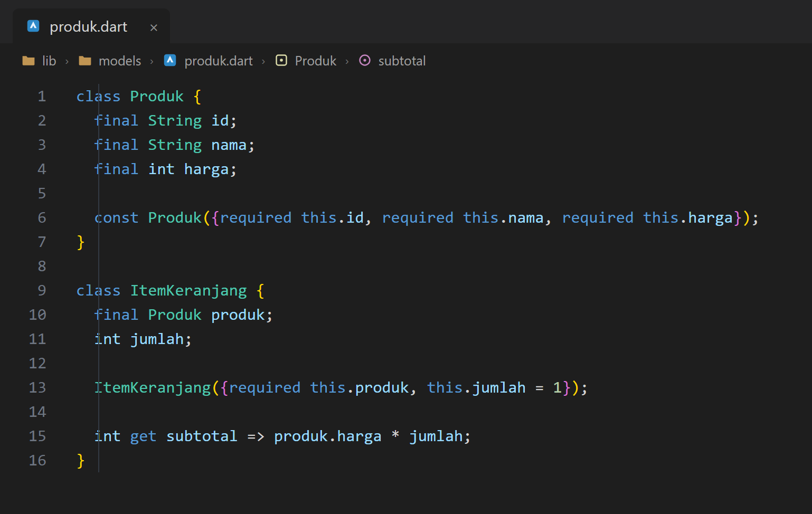

### `lib/models/pesanan.dart`

```dart
class Pesanan {
  final int? id;
  final String ringkasanItem;
  final int totalItem;
  final int totalHarga;
  final String tanggal;

  Pesanan({
    this.id,
    required this.ringkasanItem,
    required this.totalItem,
    required this.totalHarga,
    required this.tanggal,
  });

  Map<String, dynamic> toMap() {
    return {
      'id': id,
      'ringkasan_item': ringkasanItem,
      'total_item': totalItem,
      'total_harga': totalHarga,
      'tanggal': tanggal,
    };
  }

  factory Pesanan.fromMap(Map<String, dynamic> map) {
    return Pesanan(
      id: map['id'] as int?,
      ringkasanItem: map['ringkasan_item'] as String,
      totalItem: map['total_item'] as int,
      totalHarga: map['total_harga'] as int,
      tanggal: map['tanggal'] as String,
    );
  }
}
```

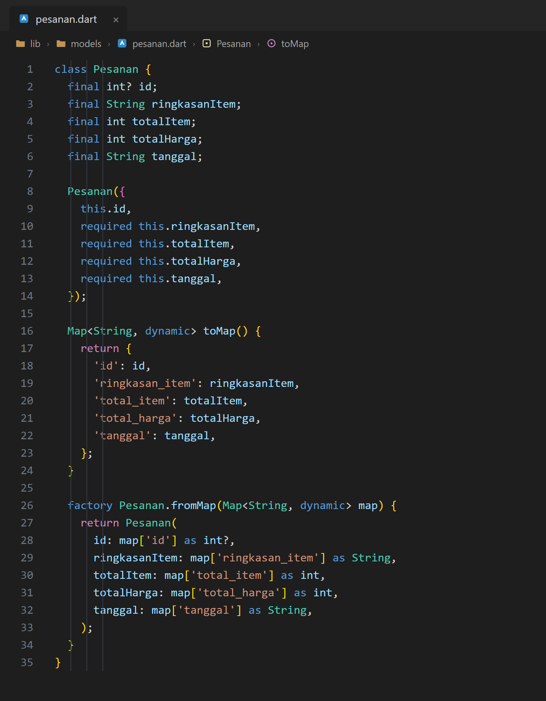

---

## lib/cubit

### `lib/cubit/keranjang_cubit.dart`

```dart
import 'package:flutter_bloc/flutter_bloc.dart';

import '../models/produk.dart';

class KeranjangCubit extends Cubit<List<ItemKeranjang>> {
  KeranjangCubit() : super([]);

  void tambah(Produk produk) {
    final daftar = List<ItemKeranjang>.from(state);
    final index = daftar.indexWhere((item) => item.produk.id == produk.id);
    if (index >= 0) {
      daftar[index].jumlah++;
    } else {
      daftar.add(ItemKeranjang(produk: produk));
    }
    emit(daftar);
  }

  void kurangi(Produk produk) {
    final daftar = List<ItemKeranjang>.from(state);
    final index = daftar.indexWhere((item) => item.produk.id == produk.id);
    if (index < 0) return;
    if (daftar[index].jumlah > 1) {
      daftar[index].jumlah--;
    } else {
      daftar.removeAt(index);
    }
    emit(daftar);
  }

  void kosongkan() {
    emit([]);
  }
}
```

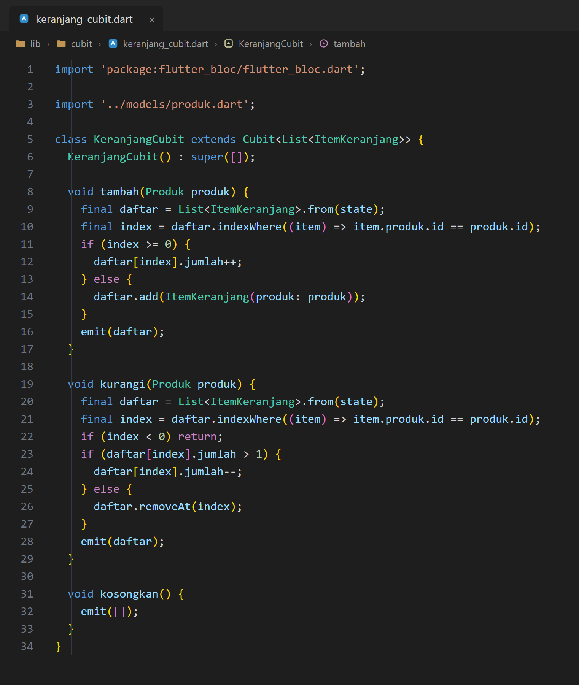

### `lib/cubit/theme_cubit.dart`

```dart
import 'package:flutter/material.dart';
import 'package:flutter_bloc/flutter_bloc.dart';

class ThemeCubit extends Cubit<ThemeMode> {
  ThemeCubit() : super(ThemeMode.system);

  void toggle() {
    emit(state == ThemeMode.dark ? ThemeMode.light : ThemeMode.dark);
  }
}
```

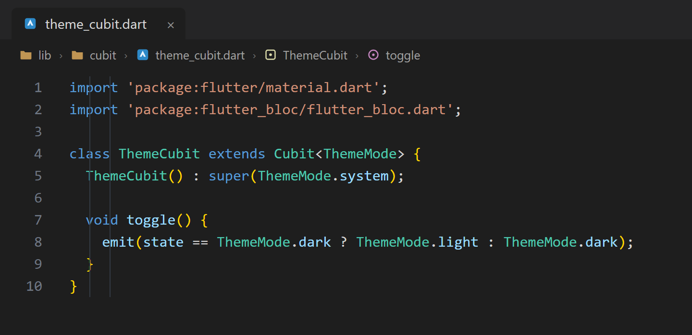

---

## lib/theme

### `lib/theme/app_theme.dart`

```dart
import 'package:flutter/material.dart';

class AppTheme {
  static const Color seedColor = Color(0xFF2E7D32);

  static ThemeData get lightTheme => ThemeData(
        useMaterial3: true,
        colorScheme: ColorScheme.fromSeed(
          seedColor: seedColor,
          brightness: Brightness.light,
        ),
        appBarTheme: const AppBarTheme(centerTitle: true),
        elevatedButtonTheme: ElevatedButtonThemeData(
          style: ElevatedButton.styleFrom(
            padding: const EdgeInsets.symmetric(horizontal: 24, vertical: 12),
            shape: RoundedRectangleBorder(borderRadius: BorderRadius.circular(12)),
          ),
        ),
        cardTheme: const CardThemeData(
          elevation: 2,
          margin: EdgeInsets.symmetric(vertical: 6, horizontal: 12),
        ),
      );

  static ThemeData get darkTheme => ThemeData(
        useMaterial3: true,
        colorScheme: ColorScheme.fromSeed(
          seedColor: seedColor,
          brightness: Brightness.dark,
        ),
        appBarTheme: const AppBarTheme(centerTitle: true),
        elevatedButtonTheme: ElevatedButtonThemeData(
          style: ElevatedButton.styleFrom(
            padding: const EdgeInsets.symmetric(horizontal: 24, vertical: 12),
            shape: RoundedRectangleBorder(borderRadius: BorderRadius.circular(12)),
          ),
        ),
      );
}
```

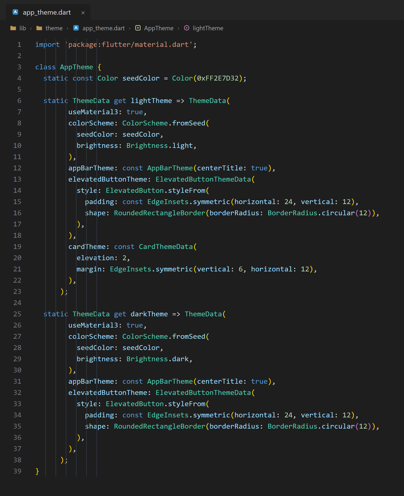

---

## lib/db

### `lib/db/database_helper.dart`

```dart
import 'package:path/path.dart';
import 'package:sqflite/sqflite.dart';
import '../models/pesanan.dart';

class DatabaseHelper {
  DatabaseHelper._internal();
  static final DatabaseHelper instance = DatabaseHelper._internal();

  Database? _database;

  Future<Database> get database async {
    _database ??= await _initDatabase();
    return _database!;
  }

  Future<Database> _initDatabase() async {
    final path = join(await getDatabasesPath(), 'kantin_kampus.db');
    return openDatabase(
      path,
      version: 1,
      onCreate: (db, version) async {
        await db.execute('''
          CREATE TABLE pesanan (
              id INTEGER PRIMARY KEY AUTOINCREMENT,
              ringkasan_item TEXT NOT NULL,
              total_item INTEGER NOT NULL,
              total_harga INTEGER NOT NULL,
              tanggal TEXT NOT NULL
          )
        ''');
      },
    );
  }

  Future<int> tambahPesanan(Pesanan pesanan) async {
    final db = await database;
    return db.insert('pesanan', pesanan.toMap());
  }

  Future<List<Pesanan>> ambilSemuaPesanan() async {
    final db = await database;
    final hasil = await db.query('pesanan', orderBy: 'id DESC');
    return hasil.map((baris) => Pesanan.fromMap(baris)).toList();
  }

  Future<int> ubahPesanan(Pesanan pesanan) async {
    final db = await database;
    return db.update(
      'pesanan',
      pesanan.toMap(),
      where: 'id = ?',
      whereArgs: [pesanan.id],
    );
  }

  Future<int> hapusPesanan(int id) async {
    final db = await database;
    return db.delete('pesanan', where: 'id = ?', whereArgs: [id]);
  }
}
```

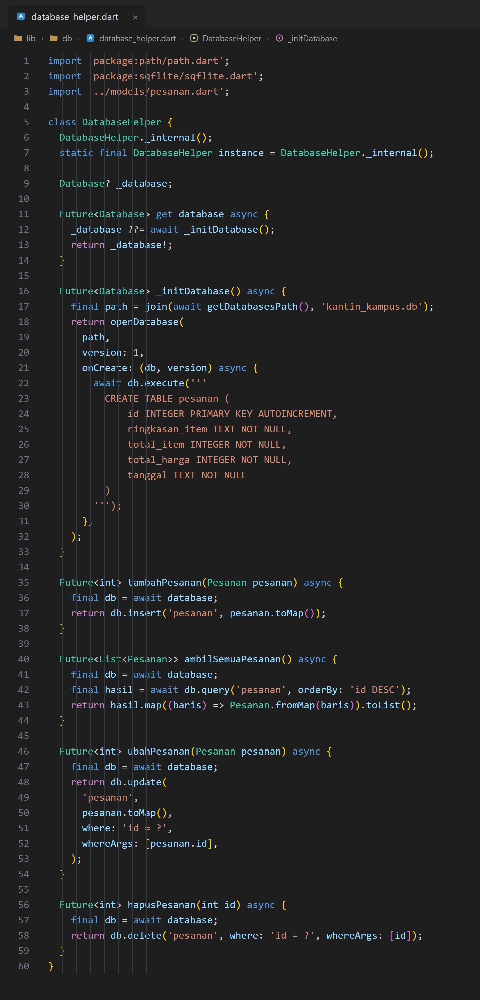

---

## lib/widgets

### `lib/widgets/primary_button.dart`

```dart
import 'package:flutter/material.dart';

class PrimaryButton extends StatelessWidget {
  final String label;
  final VoidCallback onPressed;
  final IconData? icon;

  const PrimaryButton({
    super.key,
    required this.label,
    required this.onPressed,
    this.icon,
  });

  @override
  Widget build(BuildContext context) {
    return ElevatedButton.icon(
      onPressed: onPressed,
      icon: icon != null ? Icon(icon) : const SizedBox.shrink(),
      label: Text(label),
    );
  }
}
```

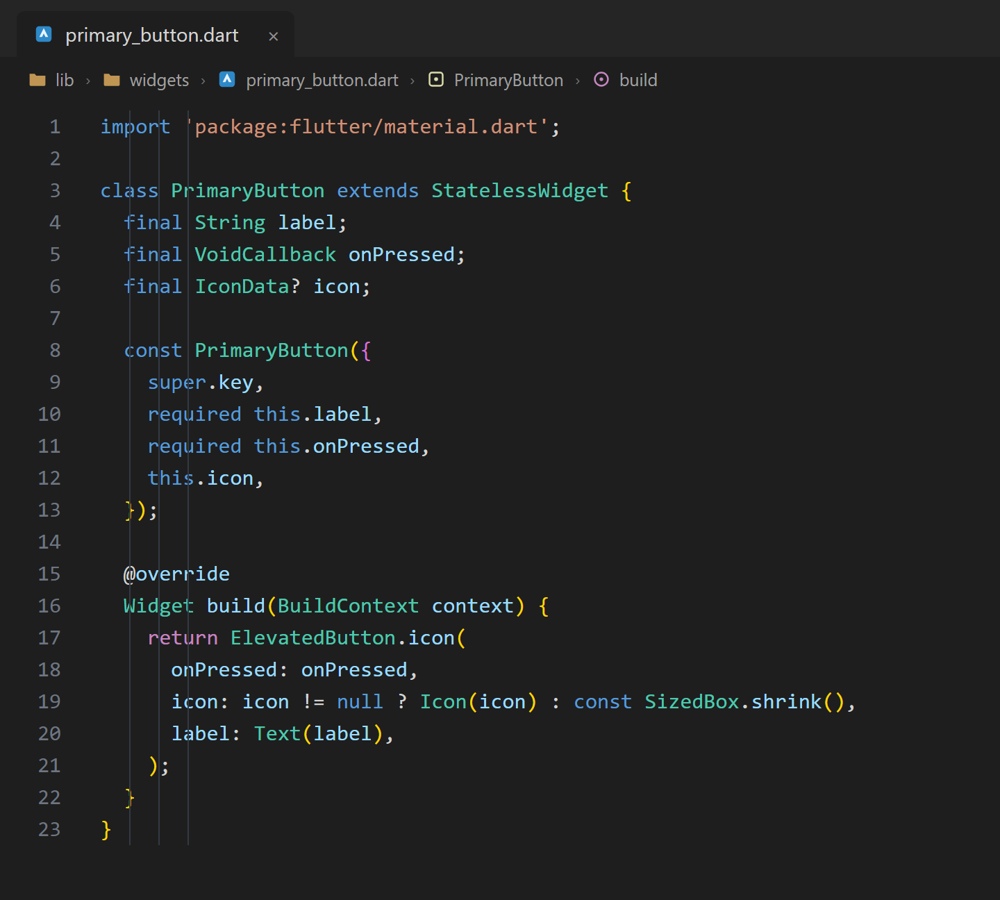

### `lib/widgets/theme_toggle_button.dart`

```dart
import 'package:flutter/material.dart';
import 'package:flutter_bloc/flutter_bloc.dart';
import '../cubit/theme_cubit.dart';

class ThemeToggleButton extends StatelessWidget {
  const ThemeToggleButton({super.key});

  @override
  Widget build(BuildContext context) {
    final mode = context.watch<ThemeCubit>().state;
    final gelap = mode == ThemeMode.dark;
    return IconButton(
      icon: Icon(gelap ? Icons.light_mode : Icons.dark_mode),
      tooltip: gelap ? 'Ganti ke mode terang' : 'Ganti ke mode gelap',
      onPressed: () => context.read<ThemeCubit>().toggle(),
    );
  }
}
```

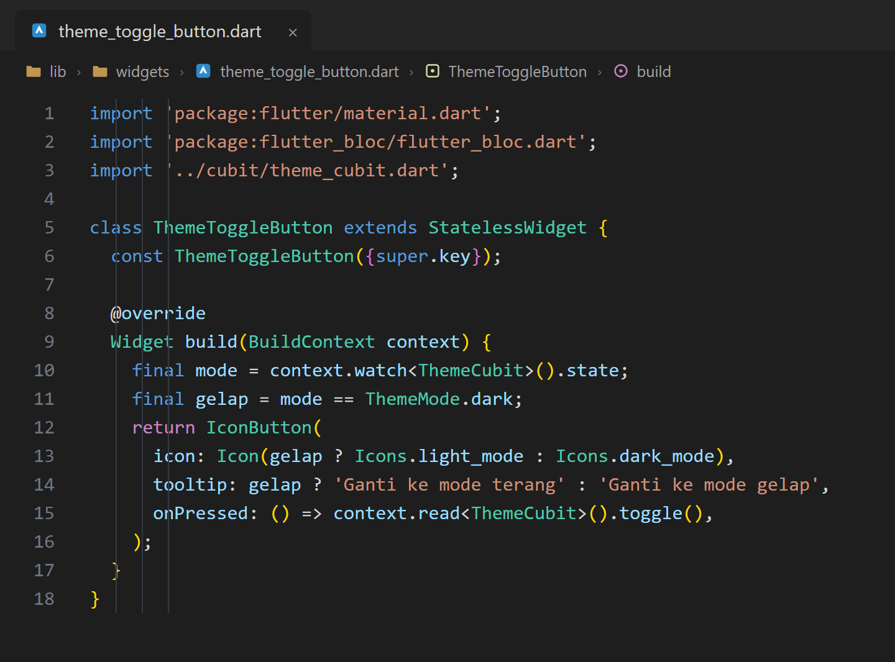

### `lib/widgets/product_card.dart`

```dart
import 'package:flutter/material.dart';
import '../models/produk.dart';

class ProductCard extends StatelessWidget {
  final Produk produk;
  final VoidCallback onTambah;

  const ProductCard({
    super.key,
    required this.produk,
    required this.onTambah,
  });

  @override
  Widget build(BuildContext context) {
    final theme = Theme.of(context);
    return Card(
      child: ListTile(
        title: Text(
          produk.nama,
          style: theme.textTheme.titleMedium,
        ),
        subtitle: Text(
          'Rp${produk.harga}',
          style: theme.textTheme.bodyMedium?.copyWith(
            color: theme.colorScheme.primary,
            fontWeight: FontWeight.bold,
          ),
        ),
        trailing: IconButton(
          icon: Icon(Icons.add_circle, color: theme.colorScheme.primary),
          onPressed: onTambah,
        ),
      ),
    );
  }
}
```

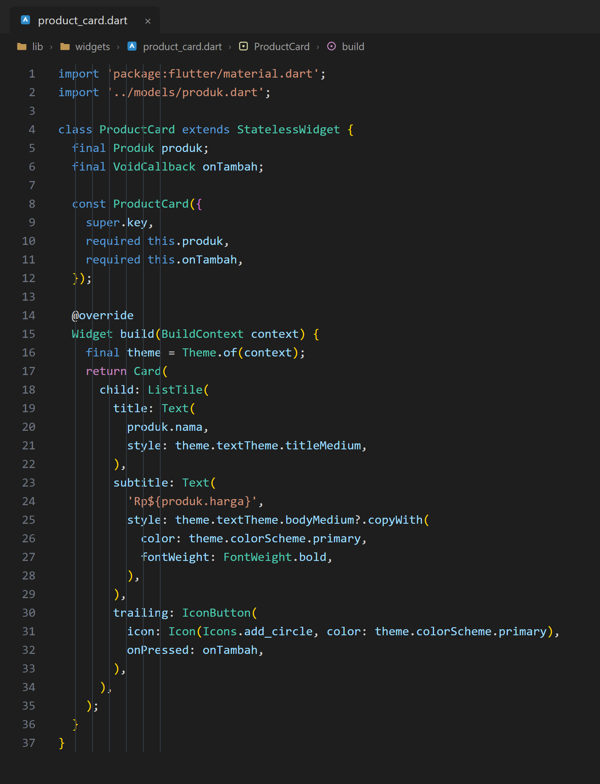

### `lib/widgets/cart_summary_bar.dart`

```dart
import 'package:flutter/material.dart';
import 'primary_button.dart';

class CartSummaryBar extends StatelessWidget {
  final int totalItem;
  final int totalHarga;
  final VoidCallback onKosongkan;
  final VoidCallback onCheckout;

  const CartSummaryBar({
    super.key,
    required this.totalItem,
    required this.totalHarga,
    required this.onKosongkan,
    required this.onCheckout,
  });

  @override
  Widget build(BuildContext context) {
    final theme = Theme.of(context);
    return Container(
      padding: const EdgeInsets.all(16),
      color: theme.colorScheme.surfaceContainerHighest,
      child: Column(
        mainAxisSize: MainAxisSize.min,
        crossAxisAlignment: CrossAxisAlignment.stretch,
        children: [
          Text('$totalItem item • Rp$totalHarga',
              style: theme.textTheme.titleMedium),
          const SizedBox(height: 8),
          Row(
            children: [
              Expanded(
                child: PrimaryButton(
                  label: 'Kosongkan',
                  icon: Icons.delete_outline,
                  onPressed: onKosongkan,
                ),
              ),
              const SizedBox(width: 8),
              Expanded(
                child: PrimaryButton(
                  label: 'Checkout',
                  icon: Icons.check_circle_outline,
                  onPressed: onCheckout,
                ),
              ),
            ],
          ),
        ],
      ),
    );
  }
}
```

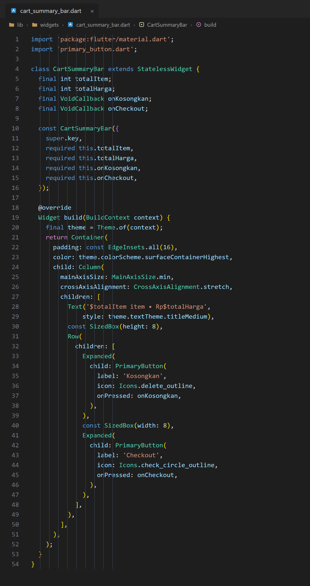

---

## lib/pages

### `lib/pages/halaman_produk.dart`

```dart
import 'package:flutter/material.dart';
import 'package:flutter_bloc/flutter_bloc.dart';
import '../cubit/keranjang_cubit.dart';
import '../models/produk.dart';
import '../widgets/product_card.dart';
import '../widgets/theme_toggle_button.dart';

class HalamanProduk extends StatelessWidget {
  const HalamanProduk({super.key});

  static const daftarProduk = [
    Produk(id: 'p1', nama: 'Nasi Goreng', harga: 15000),
    Produk(id: 'p2', nama: 'Es Teh Manis', harga: 5000),
    Produk(id: 'p3', nama: 'Ayam Geprek', harga: 18000),
  ];

  @override
  Widget build(BuildContext context) {
    return Scaffold(
      appBar: AppBar(
        title: const Text('Produk'),
        actions: const [ThemeToggleButton()],
      ),
      body: ListView.builder(
        itemCount: daftarProduk.length,
        itemBuilder: (context, index) {
          final produk = daftarProduk[index];
          return ProductCard(
            produk: produk,
            onTambah: () => context.read<KeranjangCubit>().tambah(produk),
          );
        },
      ),
    );
  }
}
```

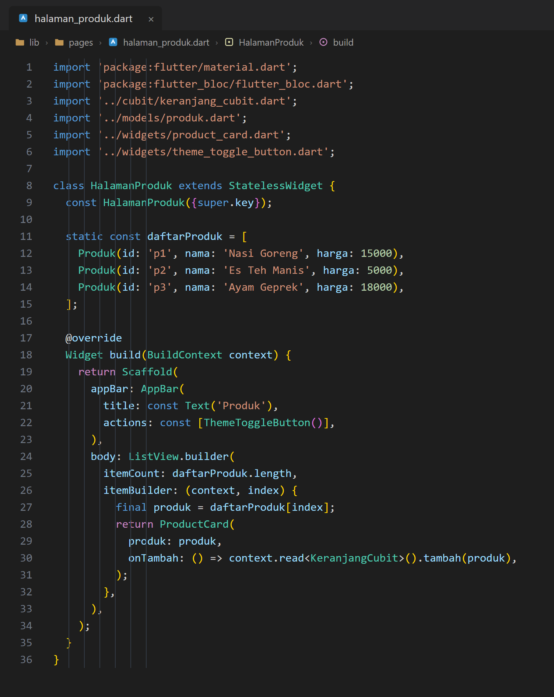

### `lib/pages/halaman_keranjang.dart`

```dart
import 'package:flutter/material.dart';
import 'package:flutter_bloc/flutter_bloc.dart';

import '../cubit/keranjang_cubit.dart';
import '../models/produk.dart';
import '../models/pesanan.dart';
import '../db/database_helper.dart';
import '../widgets/cart_summary_bar.dart';
import 'halaman_riwayat.dart';

class HalamanKeranjang extends StatelessWidget {
  const HalamanKeranjang({super.key});

  @override
  Widget build(BuildContext context) {
    return Scaffold(
      appBar: AppBar(
        title: const Text('Keranjang'),
        actions: [
          IconButton(
            icon: const Icon(Icons.receipt_long),
            onPressed: () {
              Navigator.push(
                context,
                MaterialPageRoute(builder: (_) => const HalamanRiwayat()),
              );
            },
          ),
        ],
      ),
      body: BlocBuilder<KeranjangCubit, List<ItemKeranjang>>(
        builder: (context, daftarItem) {
          final totalItem = daftarItem.fold(0, (a, b) => a + b.jumlah);
          final totalHarga = daftarItem.fold(0, (a, b) => a + b.subtotal);
          return Column(
            children: [
              Expanded(
                child: ListView.builder(
                  itemCount: daftarItem.length,
                  itemBuilder: (context, index) {
                    final item = daftarItem[index];
                    return ListTile(
                      title: Text(item.produk.nama),
                      subtitle: Text('${item.jumlah} x Rp${item.produk.harga}'),
                      trailing: Text('Rp${item.subtotal}'),
                    );
                  },
                ),
              ),
              CartSummaryBar(
                totalItem: totalItem,
                totalHarga: totalHarga,
                onKosongkan: () => context.read<KeranjangCubit>().kosongkan(),
                onCheckout: () async {
                  if (daftarItem.isEmpty) return;

                  final ringkasan =
                      daftarItem.map((item) => item.produk.nama).join(', ');

                  await DatabaseHelper.instance.tambahPesanan(
                    Pesanan(
                      ringkasanItem: ringkasan,
                      totalItem: totalItem,
                      totalHarga: totalHarga,
                      tanggal: DateTime.now().toString(),
                    ),
                  );

                  if (!context.mounted) return;
                  context.read<KeranjangCubit>().kosongkan();

                  ScaffoldMessenger.of(context).showSnackBar(
                    const SnackBar(content: Text('Pesanan berhasil disimpan.')),
                  );
                },
              ),
            ],
          );
        },
      ),
    );
  }
}
```

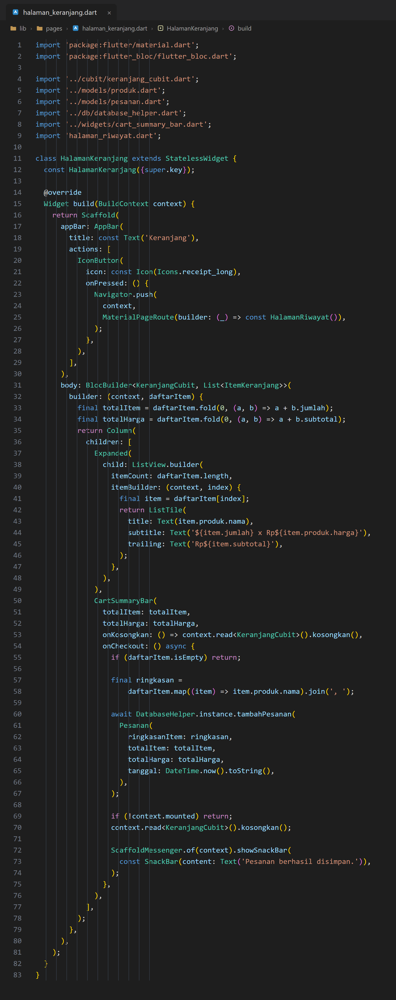

### `lib/pages/halaman_riwayat.dart`

```dart
import 'package:flutter/material.dart';
import '../db/database_helper.dart';
import '../models/pesanan.dart';

class HalamanRiwayat extends StatefulWidget {
  const HalamanRiwayat({super.key});

  @override
  State<HalamanRiwayat> createState() => _HalamanRiwayatState();
}

class _HalamanRiwayatState extends State<HalamanRiwayat> {
  late Future<List<Pesanan>> _daftarPesanan;

  @override
  void initState() {
    super.initState();
    _muatUlangData();
  }

  void _muatUlangData() {
    setState(() {
      _daftarPesanan = DatabaseHelper.instance.ambilSemuaPesanan();
    });
  }

  @override
  Widget build(BuildContext context) {
    return Scaffold(
      appBar: AppBar(title: const Text('Riwayat Pesanan')),
      body: FutureBuilder<List<Pesanan>>(
        future: _daftarPesanan,
        builder: (context, snapshot) {
          if (snapshot.connectionState == ConnectionState.waiting) {
            return const Center(child: CircularProgressIndicator());
          }
          final daftar = snapshot.data ?? [];
          if (daftar.isEmpty) {
            return const Center(child: Text('Belum ada riwayat pesanan.'));
          }
          return ListView.builder(
            itemCount: daftar.length,
            itemBuilder: (context, index) {
              final pesanan = daftar[index];
              return Dismissible(
                key: ValueKey(pesanan.id),
                direction: DismissDirection.endToStart,
                background: Container(
                  color: Colors.red,
                  alignment: Alignment.centerRight,
                  padding: const EdgeInsets.symmetric(horizontal: 20),
                  child: const Icon(Icons.delete, color: Colors.white),
                ),
                onDismissed: (direction) async {
                  await DatabaseHelper.instance.hapusPesanan(pesanan.id!);
                  if (!mounted) return;
                  _muatUlangData();
                },
                child: ListTile(
                  title: Text(pesanan.ringkasanItem),
                  subtitle: Text('${pesanan.totalItem} item • ${pesanan.tanggal}'),
                  trailing: Text('Rp${pesanan.totalHarga}'),
                  onTap: () async {
                    final controller = TextEditingController(
                      text: pesanan.totalItem.toString(),
                    );
                    final jumlahBaru = await showDialog<int>(
                      context: context,
                      builder: (context) => AlertDialog(
                        title: const Text('Ubah Jumlah Item'),
                        content: TextField(
                          controller: controller,
                          keyboardType: TextInputType.number,
                        ),
                        actions: [
                          TextButton(
                            onPressed: () => Navigator.pop(context),
                            child: const Text('Batal'),
                          ),
                          TextButton(
                            onPressed: () => Navigator.pop(
                              context,
                              int.tryParse(controller.text),
                            ),
                            child: const Text('Simpan'),
                          ),
                        ],
                      ),
                    );

                    if (jumlahBaru != null) {
                      await DatabaseHelper.instance.ubahPesanan(
                        Pesanan(
                          id: pesanan.id,
                          ringkasanItem: pesanan.ringkasanItem,
                          totalItem: jumlahBaru,
                          totalHarga: pesanan.totalHarga,
                          tanggal: pesanan.tanggal,
                        ),
                      );
                      if (!mounted) return;
                      _muatUlangData();
                    }
                  },
                ),
              );
            },
          );
        },
      ),
    );
  }
}
```

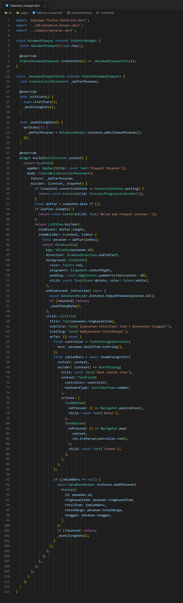

---

## lib

### `lib/main.dart`

```dart
import 'package:flutter/material.dart';
import 'package:flutter_bloc/flutter_bloc.dart';
import 'cubit/keranjang_cubit.dart';
import 'cubit/theme_cubit.dart';
import 'pages/halaman_produk.dart';
import 'pages/halaman_keranjang.dart';
import 'theme/app_theme.dart';

void main() {
  runApp(const KantinKampusApp());
}

class KantinKampusApp extends StatelessWidget {
  const KantinKampusApp({super.key});

  @override
  Widget build(BuildContext context) {
    return MultiBlocProvider(
      providers: [
        BlocProvider(create: (_) => KeranjangCubit()),
        BlocProvider(create: (_) => ThemeCubit()),
      ],
      child: BlocBuilder<ThemeCubit, ThemeMode>(
        builder: (context, themeMode) {
          return MaterialApp(
            title: 'Kantin Kampus',
            theme: AppTheme.lightTheme,
            darkTheme: AppTheme.darkTheme,
            themeMode: themeMode,
            home: const KerangkaUtama(),
          );
        },
      ),
    );
  }
}

class KerangkaUtama extends StatefulWidget {
  const KerangkaUtama({super.key});

  @override
  State<KerangkaUtama> createState() => _KerangkaUtamaState();
}

class _KerangkaUtamaState extends State<KerangkaUtama> {
  int _indeks = 0;
  final _halaman = const [HalamanProduk(), HalamanKeranjang()];

  @override
  Widget build(BuildContext context) {
    return Scaffold(
      body: _halaman[_indeks],
      bottomNavigationBar: NavigationBar(
        selectedIndex: _indeks,
        onDestinationSelected: (i) => setState(() => _indeks = i),
        destinations: const [
          NavigationDestination(icon: Icon(Icons.storefront), label: 'Produk'),
          NavigationDestination(icon: Icon(Icons.shopping_cart), label: 'Keranjang'),
        ],
      ),
    );
  }
}
```

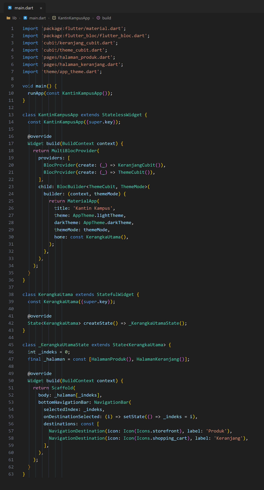

---

## Hasil Aplikasi (emulator Android)

**1. Halaman Produk**

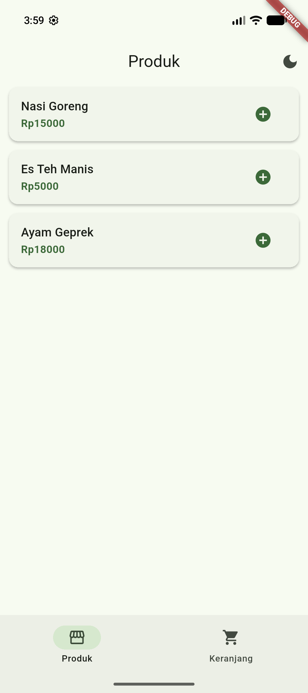

**2. Keranjang berisi item dan tombol Checkout (Create)**

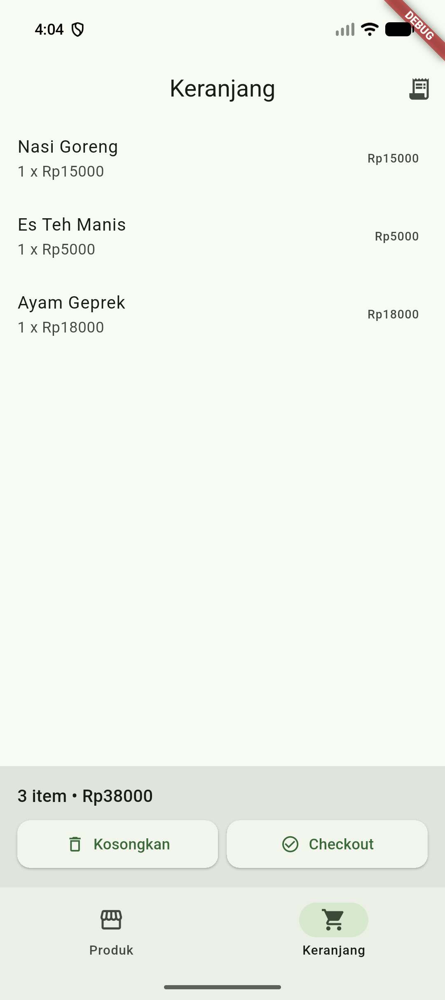

**3. Setelah Checkout: SnackBar muncul, keranjang kosong**

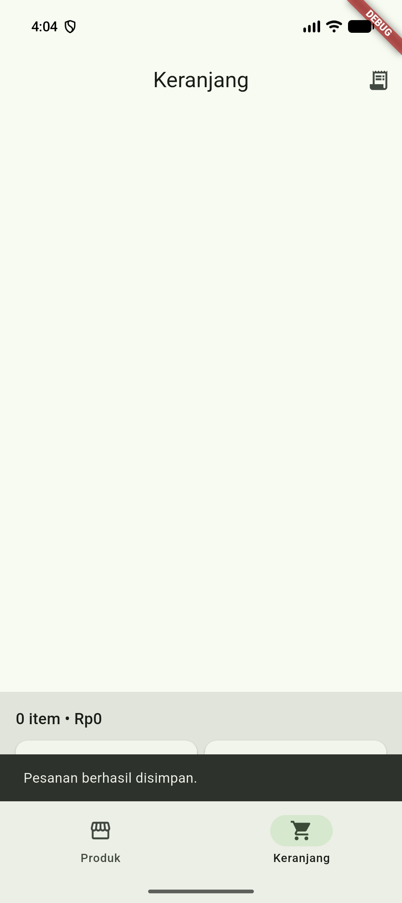

**4. Riwayat pesanan, terbaru di atas (Read)**

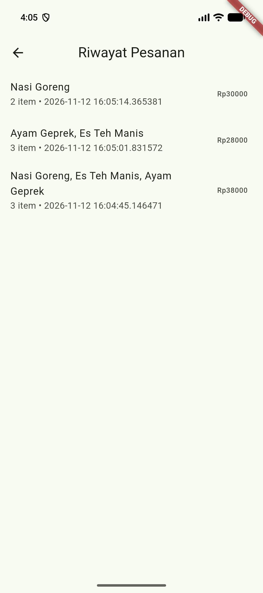

**5. Dialog ubah jumlah item (Update)**

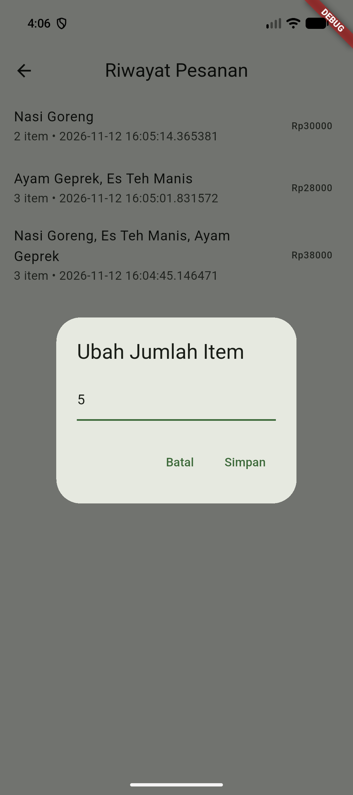

**6. Jumlah berubah dari 2 menjadi 5**

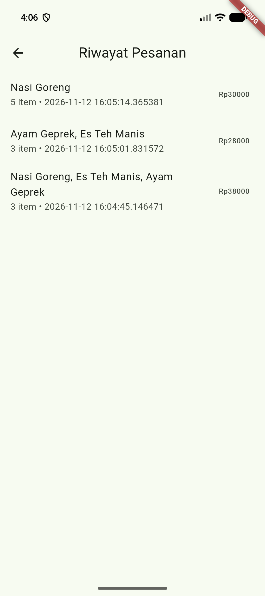

**7. Satu baris hilang setelah digeser ke kiri (Delete)**

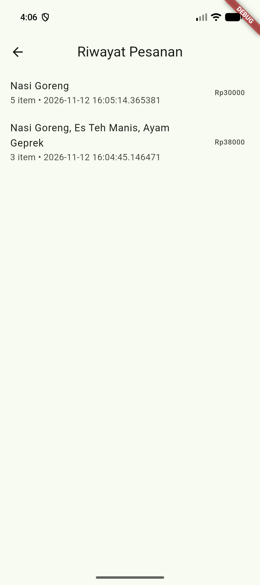

**8. Data tetap ada setelah aplikasi ditutup dan dibuka ulang**

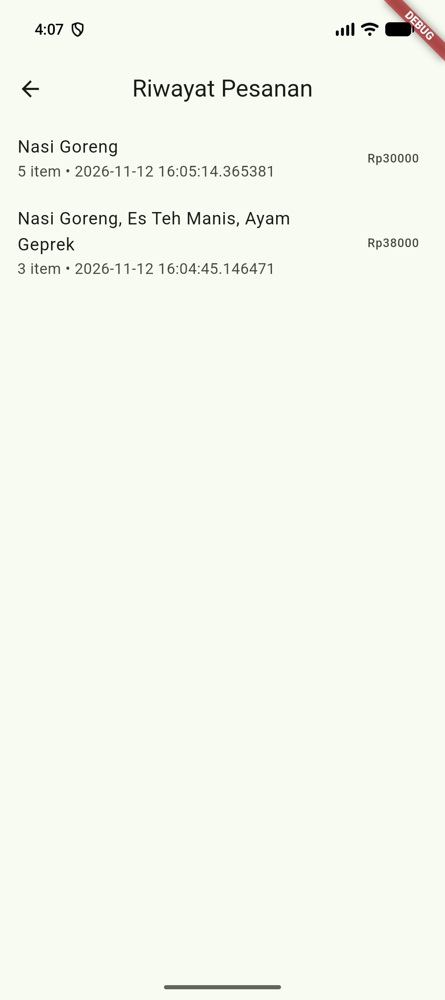
